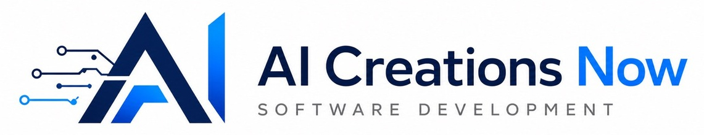

  

<h1 align="center">AI Creations Now Software Development</h1>

<strong>Practical Windows software. Clearer answers. More control.</strong>

  <a href="https://aicreatenow.com/">Company website</a> ·
  <a href="https://aicreatenow.com/software.html">Software catalog</a> ·
  <a href="https://results.aicreatenow.com/">Benchmark Results Center</a> ·
  <a href="mailto:info@aicreatenow.com">Support</a>

We build Windows applications for people who want to understand their computers, manage their networks and get useful work done. Our products serve home users, independent developers and IT professionals, alongside our network engineering, AI infrastructure consulting and custom software services.

**AI Creations Now Software Development** is based in Melville, New York, with local services on Long Island and support for national and international projects.

## ArtifactTrust Pro GUI

  

**Your software. Your signature. A guided way to sign.** ArtifactTrust Pro GUI **3.1** brings Microsoft Artifact Signing to a focused Windows interface. Sign one software file with a PDF verification report, or process up to 50 files in a batch without PDF reports. The app prepares its bundled prerequisites on first launch and guides you through connecting your existing signing resources.

**Free for everyone.** Coffee tips are optional. An eligible Microsoft account, subscription and configured signing resources are required; Microsoft service charges are separate. This is an independent application from AI Creations Now Software Development.

[Explore the product](https://github.com/aicreatenowdom/azure-artifact-signing-tool) · [Official website](https://trustprogui.com/) · [Download free for Windows x64](https://download.aicreatenow.com/software/ArtifactTrustPro3.1.0microsoft.exe) · [Screenshots](https://trustprogui.com/screenshots.html) · [Setup and help](https://trustprogui.com/help.html) · [Privacy and installation policy](https://trustprogui.com/privacy.html) · [Microsoft Store](https://apps.microsoft.com/detail/xp8lcmjczs31dn?hl=en-US&gl=US)

## ServerSight Pro

  

**See what your IIS server is doing.** ServerSight Pro **3.0.20** brings website traffic, requests, errors and Windows resource activity into one monitoring interface. Review live activity and detailed reports to understand the sites running on your server.

Start a **two-day free trial**. A **$39.99 lifetime license** covers one computer, with no subscription.

[Explore the product](https://github.com/aicreatenowdom/iis-monitor) · [Official website](https://serversightpro.com/) · [Download the free trial](https://serversightpro.com/download.html) · [Features](https://serversightpro.com/features.html) · [Setup and help](https://serversightpro.com/help.html) · [Microsoft Store](https://apps.microsoft.com/detail/xp8lmxrs0t4600?hl=en-US&gl=US)

## More ways to understand and manage your PC

**AI Now Bench 7 — a broader view of performance.** Measure CPU, graphics, memory, storage, AI compute and real-world workloads with 63 scored results across six categories. The complete Standard benchmark is free, with local reports and optional public system comparisons. [Official website](https://ainowbench.com/) · [Download](https://ainowbench.com/download.html) · [Compare systems](https://results.aicreatenow.com/explore)

**Wi-Fi Commander — your home. Your network. In focus.** Explore Wi-Fi and mesh coverage, check Internet health, monitor bandwidth, and inspect LAN devices and ports. Version 2.1.1 includes 15 functions, including nine Network / Internet Tools. [Official website](https://getwificommander.com/) · [Two-day trial](https://getwificommander.com/download.html) · [Requirements and help](https://getwificommander.com/help.html)

**Rift Conduit — a direct line to your Windows storage.** Reach files on your Windows PC or server through encrypted SFTP using your preferred file browser or remote-drive client. A separately installed SFTP client and a reachable network connection are required. [Official website](https://riftconduit.com/) · [Two-day trial](https://riftconduit.com/download.html) · [Connection guide](https://riftconduit.com/connection-guide.html)

## Free applications

| Project | What it does | Availability |
| --- | --- | --- |
| [ArtifactTrust Pro GUI](https://github.com/aicreatenowdom/azure-artifact-signing-tool) | Guided single-file or batch code signing through your existing Microsoft Artifact Signing resources. | Free Windows application; optional coffee tips. Microsoft service charges are separate. [Website](https://trustprogui.com/). |
| [AI Now Bench 7](https://github.com/aicreatenowdom/ai-now-bench-7) | 63 scored results across six PC performance categories, with reports and system comparisons. | Complete Standard benchmark is free. Advanced Pro key: free email delivery within seven days, or optional $5 priority delivery within 30 minutes for the same features. [Website](https://ainowbench.com/). |
| [PowerShell Script Runner](https://github.com/aicreatenowdom/powershell-script-runner) | Launch local PowerShell scripts as Administrator, keep the console open and revisit 20 recent scripts. | Free signed portable utility; no activation, account or payment required. [Product page](https://aicreatenow.com/scriptrunner.html). |
| [HW Info 64 Profile Loader](https://github.com/aicreatenowdom/hwinfo64-sensor-layout-profile-loader) | Save and switch ten HWiNFO64 sensor profiles, including a protected stock profile. | Free independent companion. HWiNFO64 is obtained separately under its own license. [Product page](https://aicreatenow.com/hwinfo64loader.html). |
| [Moonlight / Sunshine Companion](https://github.com/aicreatenowdom/moonlight-sunshine-companion) | Capture client and host evidence to investigate streaming latency, stutters and connection problems. | Complete package free by email within 24 hours; optional $5 donation for immediate delivery. Moonlight and Sunshine are required separately. [Product page](https://aicreatenow.com/Moonlight.html). |

## Try before you buy

| Project | What it does | Trial and license |
| --- | --- | --- |
| [ServerSight Pro](https://github.com/aicreatenowdom/iis-monitor) | Monitor IIS website activity, requests, errors and Windows server resources. | 2-day trial; $39.99 lifetime license for one computer, with no subscription. [Website](https://serversightpro.com/). |
| [Wi-Fi Commander](https://github.com/aicreatenowdom/wifi-commander) | Wi-Fi and mesh analysis, Internet health, bandwidth, LAN visibility and network diagnostic tools. | 2-day trial; $4.99 lifetime license for one computer, with no subscription. [Website](https://getwificommander.com/). |
| [Rift Conduit](https://github.com/aicreatenowdom/rift-conduit) | Encrypted SFTP access to files on your Windows PC or server using your preferred client. | 2-day trial; $7.99 lifetime license for the activated computer, including lifetime support and upgrades. [Website](https://riftconduit.com/). |
| [AOL Mail Relay System](https://github.com/aicreatenowdom/aol-mail-relay) | Forward eligible new AOL Inbox messages from an awake Windows computer while preserving the originals. | 3-day trial; $5 lifetime license for one computer. [Product page](https://aicreatenow.com/aolrelay.html). |
| [Automated Backup Packager](https://github.com/aicreatenowdom/automated-backup-packager) | Schedule standard ZIP backups of the Windows files and folders you choose. | 15-day trial; $3.99 lifetime license for one computer. [Product page](https://aicreatenow.com/backupsoftware.html). |

## Reporting for Cloudflare

| Project | What it does | Purchase and delivery |
| --- | --- | --- |
| [Cloudflare Analytics Reporter](https://github.com/aicreatenowdom/cloudflare-analytics-reporter) | Turn domain and R2 delivery analytics into scheduled HTML emails, local PDFs and rolling 30-day history. | $39.99 lifetime license for one Windows computer; software and license emailed after purchase. [Official product page](https://aicreatenow.com/cfanalytics.html). |

## Engineering services

We provide network engineering, AI compute and data-center infrastructure assessments, system optimization and custom software development. We support national and international projects, with local IT services for homes and businesses on Long Island.

[Explore our services](https://aicreatenow.com/services.html) · [Meet founder Dominick Strippoli](https://aicreatenow.com/owner.html) · [Contact us](mailto:info@aicreatenow.com)

## Product support

For product help, licensing and delivery questions, email **[info@aicreatenow.com](mailto:info@aicreatenow.com)** or call **1-866-315-4750**. Follow each product's official website for current requirements, release details and policies.

These repositories provide product documentation and artwork. The Windows applications are proprietary; their source code is not included. Free software and trial availability do not imply an open-source license. Please use each product's official download or purchase route.

---

  <a href="https://aicreatenow.com/">AI Creations Now</a> ·
  <a href="https://trustprogui.com/">ArtifactTrust Pro GUI</a> ·
  <a href="https://serversightpro.com/">ServerSight Pro</a> ·
  <a href="https://ainowbench.com/">AI Now Bench 7</a> ·
  <a href="https://getwificommander.com/">Wi-Fi Commander</a> ·
  <a href="https://riftconduit.com/">Rift Conduit</a>

© 2026 AI Creations Now Software Development

